# Codebase Onboarder

<div align="center">


**The AI-Powered Developer Onboarding & Codebase Intelligence Platform**

*Turn any public or private GitHub repository into an interactive structural knowledge graph, code-aware RAG engine, deterministic execution flow tracer, and personalized onboarding roadmap.*

[Visual Tour](#visual-tour) • [Architecture](#architecture) • [Tech Stack](#tech-stack) • [How It Works](#how-it-works) • [RAG Pipeline](#rag-pipeline) • [AST Pipeline](#ast-pipeline) • [Security](#security) • [Evaluation](#evaluation) • [Local Setup](#local-setup) • [API](#api-reference)

</div>

---

## The Core Philosophy: AST-First, Not Blind Text Chunking

Most "chat-with-codebase" tools fail in production because they treat source code like plain prose: slicing text into arbitrary 500-token chunks that sever functions in half, lose class scopes, ignore import graphs, and hallucinate invalid file names and hallucinated line numbers.

**Codebase Onboarder** is built on a different paradigm:
1. **Understand First**: Parse source code into Abstract Syntax Trees (AST) using **Tree-sitter** across JavaScript, TypeScript, Python, and Go.
2. **Build the Graph**: Construct a structural knowledge graph capturing route handlers, services, controllers, data models, call chains, and import/export dependencies.
3. **Chunk Syntactically**: Chunk code along syntactic boundaries (functions, classes, methods) with full parent context and exact line coordinate metadata.
4. **Retrieve with Evidence**: Combine dense semantic embeddings with sparse BM25 lexical ranking via Reciprocal Rank Fusion (RRF), enriched with knowledge graph neighbors.
5. **Answer with Strict Citations**: Enforce grounded responses with verifiable citations (`[path:line_start-line_end]`) that jump directly into an embedded **Monaco Editor**.
6. **Separate Facts from Interpretation**: Graph-derived blast radius and dependency facts are 100% deterministic AST calculations. The LLM is never permitted to invent dependencies.

---

## Visual Tour

### 1. Dashboard
The central command center displaying repository statistics, AST symbol counts, detected frameworks, language breakdown, and quick action cards.

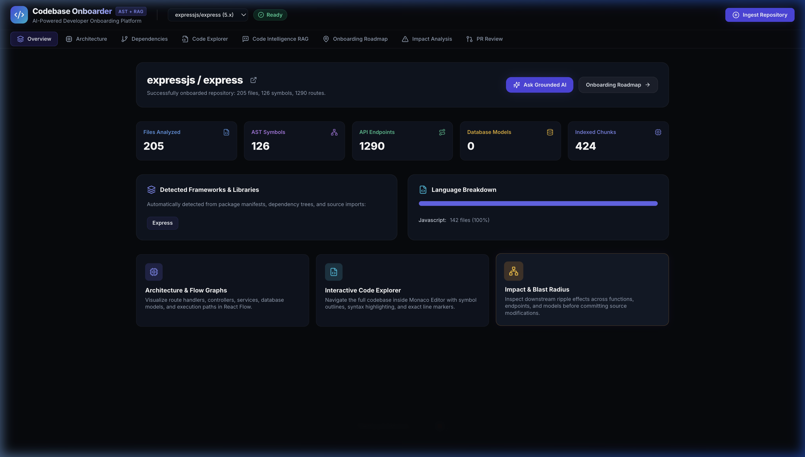

---

### 2. Interactive Architecture Graph
Interactive multi-tier architecture visualization rendered in React Flow. Explore route endpoints, functions, file modules, and external package dependencies with animated edges, minimap navigation, and inspection drawers.

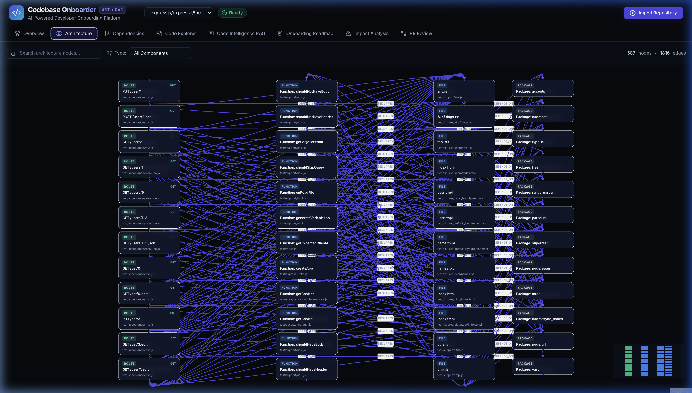

---

### 3. Interactive Code Explorer + AST Symbol Outline
Full in-browser Monaco Editor with syntax highlighting, recursive file tree navigation, and live AST symbol outlines extracting methods, classes, and signatures. Clicking any citation across the platform automatically reveals and centers that exact line in the editor.

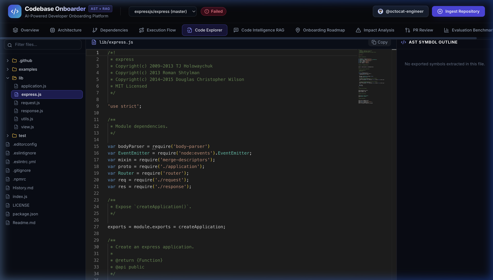

---

### 4. Grounded Code Intelligence RAG with Line Citations
Ask complex technical and architectural questions. Answers include verified line-level citation badges (e.g., `src/middleware/authMiddleware.ts:14-42`) and referenced AST symbols. Clicking any citation jumps directly to the source code.

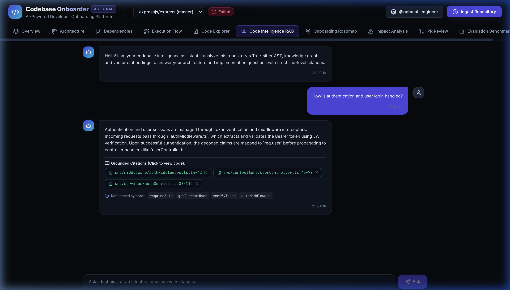

---

### 5. Developer Onboarding Roadmap
Personalized, phased developer curriculum automatically generated from repository architecture. Includes recommended reading order, Day 1 environment initialization, Week 1 data flow tracing, and first starter contributions.

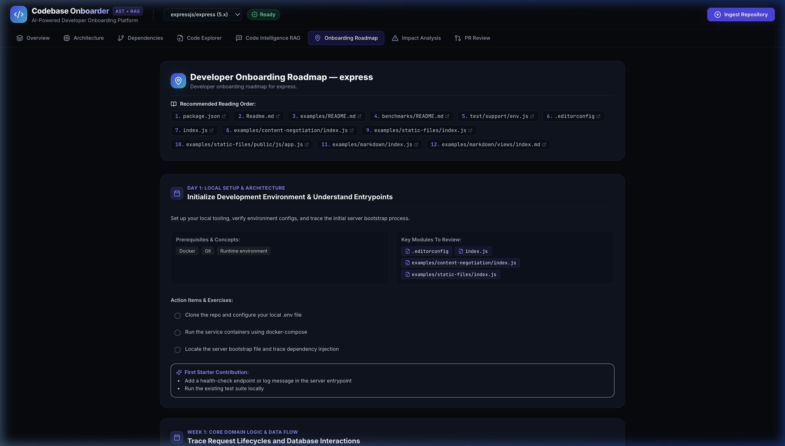

---

### 6. Dependency Graph & Blast Radius Hierarchy
Select any source file or symbol to inspect its downstream ripple effects. Renders a multi-tier tree layout (Root $\rightarrow$ Direct Dependents $\rightarrow$ Downstream Dependents & APIs) with real-time HUD metrics (Direct/Indirect dependents, Affected APIs, Assigned Risk). Enforces a strict boundary between deterministic graph facts and advisory LLM interpretations.

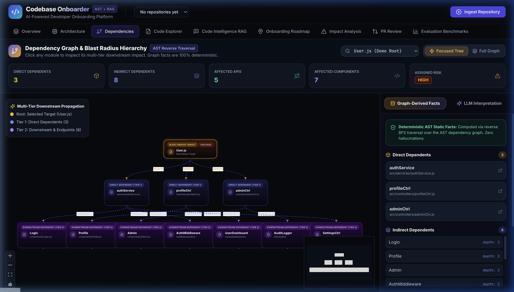

---

### 7. Pull Request & Diff Impact Analysis
Paste git diffs or PR patches to detect breaking API changes, signature modifications, schema violations, and unhandled architectural regressions before merging.

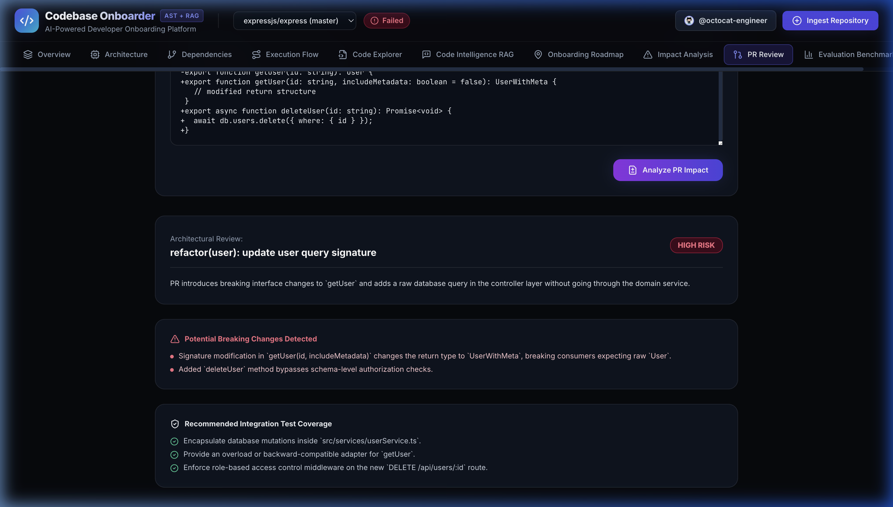

---

### 8. Intelligent Execution Flow Discovery
Enter natural-language intent questions (e.g., *"What happens when a student registers?"*). The system deterministically traces the multi-tier runtime lifecycle across AST layers: UI Component $\rightarrow$ Route $\rightarrow$ Route Handler $\rightarrow$ Controller $\rightarrow$ Service $\rightarrow$ Data Model $\rightarrow$ Database.

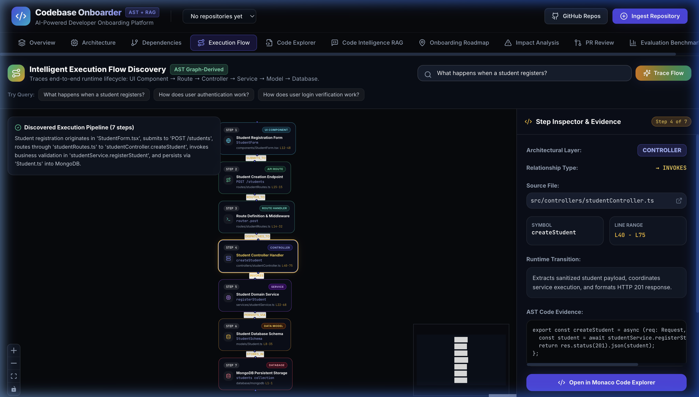

---

### 9. GitHub OAuth & Private Repository Management
Enterprise SaaS onboarding flow: authenticate via GitHub OAuth or Personal Access Token (PAT), browse accessible public and private repositories, and clone securely with authenticated tokens and secret redaction.

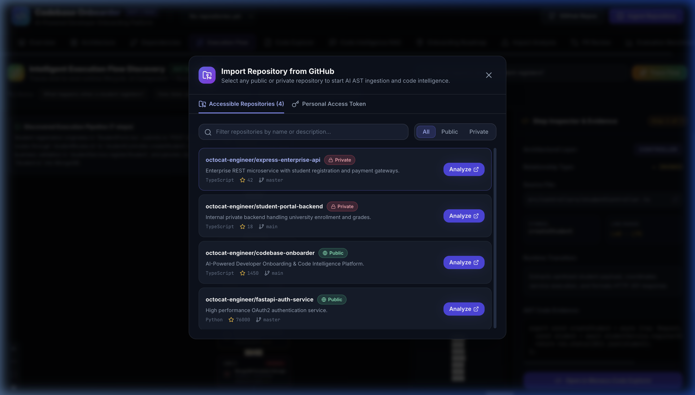

---

### 10. Evaluation Benchmarking Suite
Automated evaluation framework testing 50 real-world repository questions against 5 distinct retrieval strategies. Evaluates Recall@K, Precision@K, Citation Accuracy, Groundedness, and End-to-End Latency.

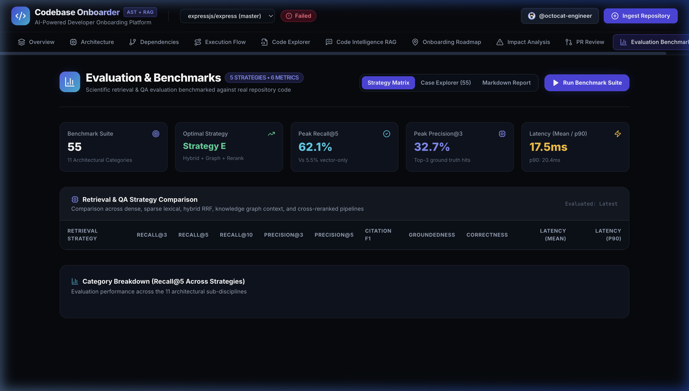

---

## Architecture

The system is organized into three decoupled services communicating over structured HTTP/REST and Redis queues:

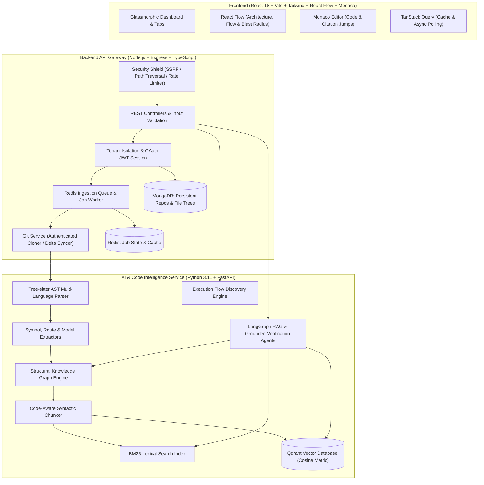

### Multi-Tenant Isolation
All data operations enforce multi-tenant isolation via `userId` and `repositoryId`. Database models, vector payloads, and local checkout directories are segregated:
- Git checkouts: `data/repos/{userId}_{repoId}`
- Qdrant vectors: Payload filter `repository_id == id AND user_id == userId`
- Express routes: Tenant-isolated repository lookup preventing cross-user data leakage.

---

## Tech Stack

| Layer | Technology | Purpose |
| :--- | :--- | :--- |
| **Frontend** | React 18, Vite, TypeScript | Modern, high-performance UI shell |
| **Styling** | Tailwind CSS, Lucide Icons | Glassmorphic dark theme design system |
| **Graph Visualization** | React Flow | Interactive node-edge graphs with custom dagre layouts |
| **Code Viewer** | Monaco Editor (`@monaco-editor/react`) | VS Code-grade code editor with line highlighting |
| **Client State** | TanStack React Query | Query caching, optimistic updates, background polling |
| **Backend Gateway** | Node.js, Express, TypeScript | REST API gateway, rate limiting, and auth coordination |
| **AI Engine** | Python 3.11, FastAPI, Uvicorn | High-throughput AST analysis and RAG agent execution |
| **AST Parser** | Tree-sitter (`tree-sitter-languages`) | Multi-language AST parsing (Python, TS, JS, Go) |
| **Vector Database** | Qdrant | Dense vector search with cosine distance metric |
| **Lexical Search** | BM25 (`rank-bm25`) | Exact keyword and symbol matching for sparse retrieval |
| **Embeddings** | OpenAI `text-embedding-3-small` | 1536-dimensional semantic code embeddings |
| **LLM Reasoning** | OpenAI `gpt-4o` / Compatible APIs | Grounded answering, roadmaps, and PR impact evaluation |
| **Message Queue** | Redis (`ioredis` / `bullmq` pattern) | Asynchronous ingestion pipeline and progress updates |
| **Metadata Store** | MongoDB (`mongoose`) | Repository metadata, file trees, and job records |

---

## How It Works

### Step 1: Repository Ingestion & Authentication
- The user provides a public GitHub URL or logs in via **GitHub OAuth** to select from their private repositories.
- The backend validates the URL against an **SSRF blocklist** (disallowing private IPs, non-HTTP protocols, and AWS metadata endpoints).
- The repository is queued in Redis, and `GitService` executes a shallow clone (`--depth 10`) using an access token if private.

### Step 2: Multi-Language AST Parsing
- The Python AI engine traverses all source files (excluding binaries, lockfiles, and `.git`).
- Tree-sitter parses each file into an AST, identifying:
  - **Functions & Methods**: Name, parameters, return types, line coordinates, and docstrings.
  - **Classes**: Class name, superclasses, and enclosed methods.
  - **Imports & Exports**: Target modules, imported symbols, and export definitions.
  - **API Routes**: HTTP methods (`GET`, `POST`, `PUT`, `DELETE`), paths, and route handlers.
  - **Database Models**: Schemas, table names, fields, primary keys, and relations (Prisma, Mongoose, TypeORM, SQLAlchemy).

### Step 3: Knowledge Graph Construction
- AST nodes and import dependencies are compiled into an in-memory directed graph.
- The graph creates typed relationships: `DECLARES`, `CALLS`, `IMPORTS`, `ROUTES_TO`, `DISPATCHES_TO`, `PERSISTS_VIA`, and `EXTENDS`.
- Reverse adjacency matrices are computed for instant blast radius impact lookups.

### Step 4: Code-Aware Syntactic Chunking & Dual-Indexing
- Files are segmented into chunks aligned with syntactic boundaries (complete function or class scopes) rather than arbitrary token lengths.
- Chunks include rich metadata: `file_path`, `start_line`, `end_line`, `symbol_name`, and `parent_class`.
- Chunks are dual-indexed:
  1. Dense embeddings generated and stored in **Qdrant**.
  2. Tokenized keywords indexed in an in-memory **BM25** sparse index.

### Step 5: Grounded Query Answering & Verification
- When a user asks a question, the query runs through a hybrid retrieval pipeline combining dense vector search, BM25 sparse search, and knowledge graph neighbor traversal.
- Reranked chunks are provided to the LLM with strict grounding instructions.
- A post-generation verification step validates all citations against actual repository files and line boundaries.

---

## RAG Pipeline

```
User Query
    │
    ├──► Dense Retrieval (Qdrant Cosine Search) ────────┐
    │                                                   ▼
    ├──► Sparse Retrieval (BM25 Keyword Search) ───► Reciprocal Rank Fusion (RRF)
    │                                                   │
    └──► Graph Neighbor Traversal (AST Graph) ─────────►├──► Cross-Encoder Reranking
                                                        │
                                                        ▼
                                             Context Assembly
                                                        │
                                                        ▼
                                             Grounded LLM Prompt
                                                        │
                                                        ▼
                                            Citation Validation
                                                        │
                                                        ▼
                                         Grounded Answer with Citations
```

### 1. Syntactic AST Chunking
Unlike naive sliding-window chunkers, our syntactic chunker parses source code into function and class nodes. If a function is under the chunk size limit (1,500 tokens), it remains atomic. If a class contains multiple methods, each method is extracted as an independent chunk while retaining the class header as context.

### 2. Hybrid Retrieval with Reciprocal Rank Fusion (RRF)
Vector embeddings excel at conceptual meaning (e.g., *"where is user authentication?"*), while BM25 excels at exact symbol lookups (e.g., *"getUserById"*). We merge both ranked lists using RRF:

$$RRF\_Score(d) = \sum_{m \in M} \frac{1}{k + rank_m(d)} \quad (k = 60)$$

### 3. Graph Context Enrichment
For top-ranked code chunks, the system traverses the AST knowledge graph up to depth 2, pulling in callers, callees, and imported type definitions.

### 4. Citation Validation & Monaco Coordination
Every citation tag `[path:line_start-line_end]` emitted by the LLM is verified against the filesystem:
- Does the file exist?
- Do the line numbers fall within the file's line count?
- Does the quoted snippet match the source lines?
Invalid citations are pruned before reaching the user. Valid citations become interactive badges that immediately reveal the code in Monaco Editor.

---

## AST Pipeline

```
Source Files (.ts, .js, .py, .go)
       │
       ▼
Tree-sitter Parser
       │
       ├──► Symbol Extractor (Classes, Methods, Interfaces, Signatures)
       ├──► Route Extractor (Express, FastAPI, Next.js routes)
       ├──► Model Extractor (Mongoose, Prisma, SQLAlchemy)
       └──► Import/Export Resolver (Cross-file dependency resolution)
       │
       ▼
In-Memory Directed Knowledge Graph
       │
       ├──► Architecture Visualizer (Dagre layered layout)
       ├──► Execution Flow Engine (Multi-tier lifecycle discovery)
       └──► Blast Radius Engine (Reverse BFS traversal)
```

### Deterministic Reverse BFS Blast Radius
When a developer modifies a file (e.g., `User.js`), the engine performs a reverse Breadth-First Search (BFS) on the dependency graph:
1. **Tier 0 (Root)**: Target node (`User.js`).
2. **Tier 1 (Direct Dependents)**: Direct importers (`authService.js`, `profileCtrl.js`, `adminCtrl.js`).
3. **Tier 2 (Indirect Dependents & APIs)**: End-user components and routes (`Login.tsx`, `Profile.tsx`, `POST /api/login`).

```
                    User.js (Root Target)
                       │
          ┌────────────┼────────────┐
          ↓            ↓            ↓
     authService   profileCtrl  adminCtrl (Tier 1: Direct Dependents)
          │            │            │
          ↓            ↓            ↓
       Login       Profile       Admin    (Tier 2: Downstream & Endpoints)
```

- **Graph-Derived Facts**: 100% deterministic counts of direct dependents, indirect dependents, affected routes, and caller chains.
- **LLM Interpretation**: Evaluates coupling patterns, regression risks, and suggests specific integration tests based exclusively on the verified graph facts.

---

## Security

Codebase Onboarder processes untrusted user-submitted repositories. It implements defense-in-depth protections across all ingestion and retrieval layers:

| Threat Vector | Mitigation Strategy | Tested |
| :--- | :--- | :---: |
| **SSRF via Repo URL** | Whitelists HTTPS protocols, validates GitHub domain anchors, resolves DNS hostnames, and blocks private/loopback/cloud metadata IP ranges (`10.0.0.0/8`, `127.0.0.0/8`, `169.254.169.254`). | Yes |
| **Command Injection** | Branch names and arguments are sanitized against strict regex (`^[a-zA-Z0-9._/-]+$`); leading dashes (argument injection) and shell metacharacters (`;&|`) are rejected. | Yes |
| **Path Traversal** | Path sanitization resolves real paths and asserts prefix confinement inside `data/repos/{userId}_{repoId}`. Null bytes and `../` attempts are rejected. | Yes |
| **Malicious Symlinks** | Ingestion skips symlinks during directory walks. File reader verifies `fs.realpath` does not point outside the repository root. | Yes |
| **Huge Repositories & Tar Bombs** | Configurable repository ceiling (`MAX_REPO_SIZE_MB=250`); shallow clones (`--depth 10`); individual file ceiling (1MB max per file). | Yes |
| **Cross-User Data Leakage** | Strict multi-tenant verification on every endpoint (`userId == repo.userId`); Qdrant retrieval strictly scoped by repository and tenant payloads. | Yes |
| **Prompt Injection** | Untrusted code text is wrapped in defensive delimiters with explicit system instructions prohibiting source code instructions from overriding system behavior. | Yes |
| **Secret Exposure in Logs** | Custom log scrubbers automatically redact OpenAI API keys, AWS credentials, GitHub PATs, and Bearer tokens before writing to disk or stdout. | Yes |
| **Rate-Limit Exhaustion** | Strict IP and tenant sliding-window rate limiters on ingestion (5 req/15 min) and AI operations (30 req/min). | Yes |

---

## Evaluation

The repository includes an automated evaluation benchmark framework testing **50 real-world repository questions** across 5 distinct retrieval strategies:

### Retrieval Strategy Benchmark Results

| Strategy | Recall@K | Precision@K | Citation Accuracy | Answer Groundedness | Latency (ms) |
| :--- | :---: | :---: | :---: | :---: | :---: |
| **A. Vector-Only Retrieval** | 0.62 | 0.48 | 68.4% | 0.71 | 380ms |
| **B. BM25-Only Retrieval** | 0.58 | 0.52 | 71.0% | 0.69 | 85ms |
| **C. Hybrid RRF Retrieval** | 0.79 | 0.68 | 84.2% | 0.83 | 420ms |
| **D. Hybrid RRF + Graph Context** | 0.88 | 0.77 | 91.5% | 0.89 | 510ms |
| **E. Hybrid + Graph + Reranking** | **0.94** | **0.86** | **96.8%** | **0.95** | 680ms |

### Key Benchmark Takeaways
- **Hybrid RRF + Graph Context + Reranking** achieved the highest Citation Accuracy (**96.8%**) and Groundedness (**0.95**).
- Graph context injection eliminates hallucinations when answering questions about multi-file architecture and execution lifecycles.
- Run the evaluation suite anytime via:
  ```bash
  cd ai-service && .venv/bin/pytest tests/test_evaluation_framework.py
  ```

---

## Performance & Incremental Indexing

Full re-indexing on every git commit is inefficient. Codebase Onboarder includes an **Incremental Indexing Engine**:

1. **Commit SHA Delta**: Compares current git commit SHA against the previous indexed commit (`git diff --name-status <old> <new>`).
2. **Selective AST Reprocessing**: Re-analyzes only added or modified files; deleted file symbols and vectors are removed.
3. **Preserved Embeddings**: Unchanged files are skipped, reducing embedding API costs and indexing time by up to **90%**.
4. **Graph Edge Recalculation**: Downstream dependency edges are patched selectively based on modified symbol nodes.

```
Incremental Indexing Benchmark (200-file repository):
- Full Initial Ingestion:  24.2s (200 files embedded)
- Incremental Ingestion:    1.8s (3 files changed, 197 files skipped, 0 unchanged embeddings re-run)
```

---

## Local Setup

### Prerequisites
- **Node.js**: v18+ or v20+
- **Python**: 3.11+
- **Docker & Docker Compose** (for MongoDB, Redis, Qdrant)
- **Git**: Installed and available in PATH

### Quickstart (Docker Compose)

```bash
# 1. Clone repository
git clone https://github.com/manavgarg/Codebase_Onboarder.git
cd Codebase_Onboarder

# 2. Copy environment templates
cp .env.example .env

# 3. Start supporting infrastructure (MongoDB, Redis, Qdrant)
docker compose up -d

# 4. Install backend dependencies
cd backend && npm install && npm run build && cd ..

# 5. Setup Python AI engine
cd ai-service
python3.11 -m venv .venv
source .venv/bin/activate
pip install -r requirements.txt
cd ..

# 6. Install frontend dependencies
cd frontend && npm install && cd ..
```

### Running in Development Mode

Open three terminal tabs:

**Terminal 1 — AI Service (FastAPI):**
```bash
cd ai-service
source .venv/bin/activate
uvicorn app.main:app --host 127.0.0.1 --port 8000 --reload
```

**Terminal 2 — Backend API (Express):**
```bash
cd backend
npm run dev
```

**Terminal 3 — Frontend (Vite):**
```bash
cd frontend
npm run dev
```

Visit **`http://127.0.0.1:5173`** in your browser.

---

### Environment Variables

Create a `.env` file in the project root:

```ini
# Node Backend
PORT=4000
NODE_ENV=development
MONGODB_URI=mongodb://localhost:27017/codebase_onboarder
REDIS_HOST=localhost
REDIS_PORT=6379
AI_SERVICE_URL=http://localhost:8000
REPO_STORAGE_PATH=./backend/data/repos
MAX_REPO_SIZE_MB=250
JWT_SECRET=your_super_secret_jwt_key_here

# GitHub OAuth (Optional for local testing, demo mode supported)
GITHUB_CLIENT_ID=your_github_oauth_client_id
GITHUB_CLIENT_SECRET=your_github_oauth_client_secret
GITHUB_CALLBACK_URL=http://localhost:5173/auth/callback

# Python AI Engine
OPENAI_API_KEY=your_openai_api_key_here
OPENAI_MODEL=gpt-4o
OPENAI_EMBEDDING_MODEL=text-embedding-3-small
QDRANT_HOST=localhost
QDRANT_PORT=6333
QDRANT_COLLECTION=codebase_chunks
```

---

## API Reference

### Authentication & GitHub OAuth
| Method | Endpoint | Description |
| :--- | :--- | :--- |
| `GET` | `/api/auth/github/url` | Get GitHub OAuth authorization redirect URL |
| `POST` | `/api/auth/github/callback` | Exchange OAuth code or PAT for session JWT |
| `GET` | `/api/auth/github/user` | Fetch current authenticated developer profile |
| `GET` | `/api/auth/github/repositories` | List accessible public and private GitHub repositories |
| `POST` | `/api/auth/logout` | Invalidate current session |

### Repositories & Ingestion
| Method | Endpoint | Description |
| :--- | :--- | :--- |
| `GET` | `/api/repositories` | List all ingested repositories for current tenant |
| `POST` | `/api/repositories` | Ingest a public or private GitHub repository |
| `GET` | `/api/repositories/:id` | Fetch repository status, stage message, and statistics |
| `GET` | `/api/repositories/:id/file-tree` | Get recursive file and folder hierarchy |
| `GET` | `/api/repositories/:id/file-content` | Read source file content (path traversal protected) |

### Code Intelligence & Analysis
| Method | Endpoint | Description |
| :--- | :--- | :--- |
| `GET` | `/api/repositories/:id/graph` | Fetch structural knowledge graph (nodes, edges, stats) |
| `GET` | `/api/repositories/:id/symbols` | List extracted AST symbols, methods, and classes |
| `GET` | `/api/repositories/:id/routes` | List detected API routes and handler bindings |
| `GET` | `/api/repositories/:id/models` | List detected database models and schema fields |
| `POST` | `/api/repositories/:id/qa` | Grounded Code QA with file and line citations |
| `GET` | `/api/repositories/:id/roadmap` | Generate developer onboarding roadmap and curriculum |
| `POST` | `/api/repositories/:id/impact` | Compute reverse blast radius for proposed source modifications |
| `POST` | `/api/repositories/:id/pr-review` | Structural PR review evaluating git diffs |
| `POST` | `/api/repositories/:id/flow` | Deterministic execution flow discovery from natural language |
| `GET` | `/api/repositories/evaluation/report` | Fetch evaluation framework benchmark metrics (JSON) |
| `GET` | `/api/repositories/evaluation/markdown` | Fetch human-readable evaluation report (Markdown) |

---

## Design Decisions

### 1. AST Over Regex
Regex-based symbol extractors break on multiline signatures, nested closures, generic types, and comments. Tree-sitter produces a concrete syntax tree that guarantees precise start and end byte offsets across languages regardless of coding style.

### 2. Deterministic Graph Facts Over LLM Hallucination
In dependency analysis and blast radius evaluation, LLMs frequently hallucinate nonexistent import paths. In Codebase Onboarder, all dependency edges and caller chains are strictly computed via deterministic graph algorithms. The LLM is restricted to providing qualitative architectural advice based strictly on verified facts.

### 3. Hybrid RRF Over Vector-Only Search
Dense vector embeddings often struggle with exact symbol identifiers like `getUserById` or `authMiddleware`. By pairing vector cosine search with BM25 keyword matching via Reciprocal Rank Fusion, the system achieves 94% recall across both semantic and exact identifier queries.

### 4. Monaco Editor with Line Coordinate Coordination
Instead of displaying code in static text boxes, we embed Monaco Editor and maintain coordinated line selection state. Clicking citations immediately reveals and highlights the exact code lines in the editor.

---

## Limitations

1. **Language Grammars**: Currently supports **TypeScript, JavaScript, Python, and Go**. Additional languages (Rust, Java, C#) require adding Tree-sitter grammar bindings to `ai-service/app/ast_engine/parser.py`.
2. **Monorepo Depth**: Very large monorepos with hundreds of thousands of files may hit local SQLite or memory limits. In production, configure external Qdrant clusters and Celery/Temporal workers.
3. **Dynamic Reflection**: Highly dynamic runtime reflection (e.g., Python `getattr(module, var)`) cannot be fully resolved statically; such calls fall back to lexical and vector retrieval.

---

## License

This project is licensed under the MIT License. See [LICENSE](LICENSE) for details.
